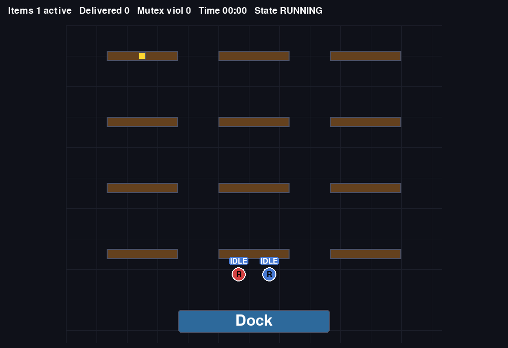

# ACIES

**A Self-Evolving Agentic Contract-Based Framework for Cyber-Physical System Control Synthesis.**

[](LICENSE)
[](https://www.python.org/downloads/)

<p align="center">
  
  <br>
  <em>Two robots, one shared dock: both controllers and the Arbiter were synthesized from natural-language requirements.</em>
</p>

Write what a robot team should do in plain language. ACIES formalizes it,
generates a control architecture that realizes it, proves the parts fit
together, and synthesizes a provably correct controller for each part.

Within one synthesis episode, a **Translator** agent turns the
natural-language requirements into linear temporal logic (LTL), and a
**Decomposer** agent structures them into a system-level assume-guarantee
contract plus one component-level contract per robot and coordinator.
Formal verification is built into the decomposition loop: CHASE
`logics_tool` + nuXmv check that the component contracts are consistent,
compatible, and refine the system contract, and SLUGS synthesizes one
finite-state controller per contract from its GR(1) game. Every failed
check returns a diagnostic, a counterexample trace or a minimal
unrealizable core, that drives repair of the system or component
contracts. Across episodes, a **Summarizer** agent distills the
verification outcomes into a lesson (failure pattern, root cause, fix
rule) kept in memory and recalled at the start of the next episode, so
the framework improves with experience: fewer repair rounds, lower cost.
The certified controllers then run in a 2D simulator under a
control-barrier-function safety filter.


Across five control synthesis tasks and eight LLM backbones, the
formalized requirements are decomposed and mapped to a synthesizable
control architecture that realizes them, and self-evolution reduces the
Decomposer token consumption by up to 65% and the end-to-end synthesis
latency by up to 62%.

## Installation

```bash
git clone https://github.com/dinghongsong26/ACIES.git
cd ACIES
conda create -n acies python=3.10 -y && conda activate acies
pip install -r requirements.txt
```

The symbolic tools are installed separately and carry their own licenses:
[CHASE](https://chase-cps.github.io) (`logics_tool`), nuXmv (free for
non-commercial use, not redistributable) and SLUGS (BSD). ACIES only
invokes them as external executables, located through environment
variables. Copy [`.env.example`](.env.example) to `.env`, fill in one API
key and the tool paths, and source it:

```bash
cp .env.example .env      # GEMINI_API_KEY, NUXMV, SLUGS, SLUGS_COMP, LOGICS_TOOL
source .env
```

`.env` is gitignored, so keys are never committed.

## Quick start

`main.py` is the single entry point. It runs the task layer (synthesize,
or reuse existing FSMs), then the physical layer (execute them in the
matching simulator and export a GIF).

```bash
python main.py --task warehouse --n 1              # full two-layer run
python main.py --task warehouse --n 2 --no-sim     # task layer only
python main.py --task warehouse --n 2 --resynth    # force re-synthesis
python main.py --task warehouse --n 1 --retranslate  # ignore the Translator cache
```

A run prints one block per agent and one line per check, in this order:

| Step | Check | Tool |
|---|---|---|
| Translator | NL requirements → LTL; coverage, lint, translation realizability | LLM, Python, CHASE `logics_tool` + SLUGS |
| 1 | Contracts generated | LLM |
| 2 | Grounding: every variable binds to the simulator vocabulary | Python |
| 3 | Syntax check | CHASE `logics_tool` |
| 4–8 | GR(1) fragment, initial values, variable ownership, mission anchoring, goal witness | Python |
| 9 | Mechanical completion (assumption discharge, persistence, cycle folding) | Python + SLUGS |
| 10 | Consistency & compatibility | CHASE `logics_tool` + nuXmv |
| 11 | Refinement of the System contract | CHASE `logics_tool` + nuXmv IC3 |
| 12 | FSM synthesis, one per contract | CHASE `logics_tool` + SLUGS |

Artifacts land under `outputs/<task>_n<N>/`: the Translator and
Decomposer outputs, the contracts (`specs.ltl`), the synthesized FSMs
(`workdir/*.json`), `result.json` with time and token cost, and
`physical_simulation.gif`. [`outputs/warehouse_n1/`](outputs/warehouse_n1/)
is a complete single-robot example run (Gemini 3.1 Pro, 263 s end to end,
47k tokens, $0.38).

To run a simulator on existing FSMs without any LLM call, for example the
frozen two-robot warehouse controllers in [`golden/`](golden/):

```bash
python -m simulator --task warehouse --robot1 golden/warehouse/robot1.json \
    --robot2 golden/warehouse/robot2.json --arbiter golden/warehouse/arbiter.json
```

**Models (`--model`).** `gemini` (default, Gemini 3.1 Pro), `gpt`,
`claude`, `deepseek`, `glm`, `kimi`; the full alias table is in
[`contrauto/llm.py`](contrauto/llm.py), and any LiteLLM model id is
accepted as well.

## Tasks

A task is one YAML in [`contrauto/tasks/`](contrauto/tasks/): an
architecture (nodes and communication edges) and plain natural-language
requirements. No formula is written by hand.

| Task (`--task`) | Scenario |
|---|---|
| `warehouse` (`--n N`) | N AGVs fetch items from a shelf and deliver them to a capacity-limited dock; an arbiter grants dock access. |
| `charger` (`--n N`) | N robots share one charging pad under an arbiter. |
| `corridor` (`--n N`) | N robots cross a single-lane corridor under an arbiter. |

The worker-scalable tasks declare one `Robot1` template, cloned into
`Robot1..RobotN` by `--n`. To define a new task, copy
[`warehouse.yaml`](contrauto/tasks/warehouse.yaml) and edit its
requirements; connecting a simulator is described in
[docs/BRING_YOUR_OWN_SIMULATOR.md](docs/BRING_YOUR_OWN_SIMULATOR.md).

## Repository layout

| Path | Contents |
|---|---|
| [`contrauto/`](contrauto/) | The task layer: agents (Translator, Decomposer, Summarizer), prompts, mechanical checks, feedback and QuickXplain cores, the tool pipeline around CHASE / nuXmv / SLUGS |
| [`simulator/`](simulator/) | Continuous simulators (pygame), FSM binding, GIF export |
| [`cbf/`](cbf/) | The CBF-QP filter and motion model |
| [`physics/`](physics/), [`maps/`](maps/) | Robot dynamics and map layouts |
| [`golden/`](golden/) | Frozen, verified contracts and FSMs for testing the physical layer without an LLM |
| [`experiments/`](experiments/) | Evaluation harnesses ([README](experiments/README.md)) |
| [`tests/`](tests/) | `pytest` suite |

## Documentation

- [Framework](docs/FRAMEWORK.md): the two layers and the certificate ladder.
- [Grounding](docs/GROUNDING.md): how contract variables bind to simulator sensors and actions.
- [Bring your own simulator](docs/BRING_YOUR_OWN_SIMULATOR.md): the adapter interface.
- [References](references.md): the contract-based design lineage ACIES builds on.

## Tests

```bash
pytest
```

The mechanics tests need no external tools; the simulator tests skip
until FSMs have been synthesized (for example by
`python main.py --task warehouse --n 2 --no-sim`).

## Citation

```bibtex
@misc{xiao2026acies,
  title  = {{ACIES}: A Self-Evolving Agentic Contract-Based Framework for
            Cyber-Physical System Control Synthesis},
  author = {Xiao, Yifeng and Ni, Zhiyu and Song, Dinghong and Zhou, Mi and
            Nuzzo, Pierluigi},
  year   = {2026}
}
```

## License

MIT, see [`LICENSE`](LICENSE). nuXmv, SLUGS and CHASE are not bundled
and keep their own licenses.
